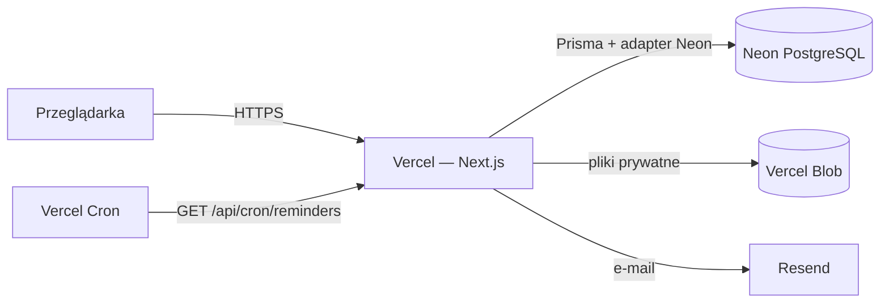

# Architektura systemu

Dokumentacja techniczna przeznaczona dla zespołu IT klienta lub wykonawcy przejmującego utrzymanie systemu. Opisuje budowę aplikacji, konfigurację, wdrożenie, bezpieczeństwo, logikę obliczeń i procedury utrzymaniowe. Instrukcja dla użytkowników końcowych znajduje się w `docs/manual/`.

## Przegląd

System to jedna aplikacja webowa **Next.js** (App Router) wdrażana na **Vercel**. Interfejs, logika biznesowa i dostęp do danych działają w tym samym projekcie — nie ma osobnego backendu.

| Element | Rola |
|---|---|
| **Next.js 16 / React 19** | Strony renderowane po stronie serwera (Server Components), formularze przez Server Actions |
| **Neon PostgreSQL** | Jedyna baza danych — wszystkie dane systemu |
| **Vercel Blob (prywatny)** | Pliki: XML faktur, PDF-y dowodowe, pliki zarchiwizowanych raportów |
| **Resend** | Wysyłka e-maili: zaproszenia, linki do zmiany hasła, przypomnienia |
| **Vercel Cron** | Comiesięczne przypomnienia o brakujących danych i wygasających wskaźnikach |

## Stos technologiczny

| Warstwa | Technologia |
|---|---|
| Język | TypeScript (tryb `strict`) |
| Framework | Next.js 16 (App Router, Turbopack), React 19 |
| UI | Tailwind CSS 4, komponenty własne w stylu shadcn/ui, ikony lucide-react |
| Wykresy | Recharts |
| Baza danych | PostgreSQL (Neon) przez Prisma ORM 7 z adapterem `@prisma/adapter-neon` |
| Walidacja | Zod (wspólne schematy w `schemas/`) |
| Sesje | JWT HS256 (`jose`) w ciasteczku httpOnly, hasła `bcryptjs` |
| Import plików | `fast-xml-parser` (KSeF XML), SheetJS `xlsx` (XLSX/XLS/ODS) |
| Eksport raportów | jsPDF + jspdf-autotable (PDF), SheetJS (XLSX), PapaParse (CSV) |
| Pliki | `@vercel/blob` (dostęp prywatny) |
| E-mail | `resend` |
| Instrukcja | `react-markdown` + `remark-gfm` |
| Testy | wbudowany runner Node (`node --test`) + `tsx` |

## Struktura katalogów

| Katalog | Zawartość |
|---|---|
| `app/(auth)/` | Strony publiczne: logowanie, aktywacja zaproszenia, reset hasła |
| `app/(dashboard)/` | Strony po zalogowaniu: dashboard, faktury, źródła, wskaźniki, raporty, firma, administracja, instrukcja |
| `app/api/` | Route handlery: pobieranie plików, raporty, CSV dziennika, cron, setup |
| `components/` | Komponenty React pogrupowane według modułu (`entries`, `reports`, `admin`…) oraz `ui/` |
| `lib/` | Logika: `auth`, `db` (zapytania), `emissions` (obliczenia), `import` (parsery), `reports`, `reminders`, `email`, `audit` |
| `lib/*/actions.ts` | Server Actions — jedyne miejsce, w którym interfejs zmienia dane |
| `lib/generated/prisma/` | Wygenerowany klient Prisma (tworzony przez `prisma generate`, nie edytować) |
| `schemas/` | Schematy Zod współdzielone przez formularze i akcje |
| `prisma/` | `schema.prisma`, migracje SQL, `seed.ts` |
| `docs/manual/` | Instrukcja użytkownika (wyświetlana w aplikacji pod `/manual`) |
| `docs/technical/` | Ta dokumentacja (w aplikacji pod `/manual/techniczna`, tylko rola Administrator) |
| `proxy.ts` | Wstępna kontrola sesji dla każdego żądania strony (dawniej `middleware.ts`) |
| `vercel.json` | Harmonogram zadań cron |

## Przepływ żądania

1. **`proxy.ts`** sprawdza podpis JWT w ciasteczku `session`. Bez ważnej sesji przekierowuje na `/login`; zalogowanego użytkownika odsyła ze stron publicznych na `/dashboard`. Ścieżki `/api/*` są wyłączone z proxy — każdy handler sam sprawdza uprawnienia.
2. **Strona (Server Component)** wywołuje `getCurrentUser()` (`lib/db/users.ts`), które odczytuje sesję i **zawsze** pobiera użytkownika z bazy. Konto dezaktywowane lub usunięte jest natychmiast wylogowywane, nawet przy ważnym tokenie.
3. **Dane** pobierane są funkcjami z `lib/db/*` i `lib/reports/query.ts` bezpośrednio w komponentach serwerowych.
4. **Zmiany** wykonują Server Actions (`"use server"`). Każda akcja: sprawdza użytkownika i rolę, waliduje dane schematem Zod, zapisuje zmianę, dopisuje wpis do dziennika zdarzeń i odświeża ścieżki (`revalidatePath`).

## Zasady w kodzie

- **Logika czysta osobno od serwerowej.** Obliczenia, reguły i parsery (`lib/emissions`, `lib/reminders/rules.ts`, `lib/auth/reset-rules.ts`…) nie importują bazy ani `server-only`, dzięki czemu są testowane jednostkowo.
- **Liczby dziesiętne.** Ilości, wskaźniki i emisje przechowywane są jako `Decimal` (PostgreSQL `numeric`), a liczone przez `Prisma.Decimal` — nigdy przez `number` przy zapisie.
- **Daty okresów** przesyłane są jako `RRRR-MM-DD` i interpretowane w UTC.
- **Interfejs po polsku**, identyfikatory w kodzie po angielsku.
- **Testy** tylko w `lib/**/*.test.ts`: `npm test`.
