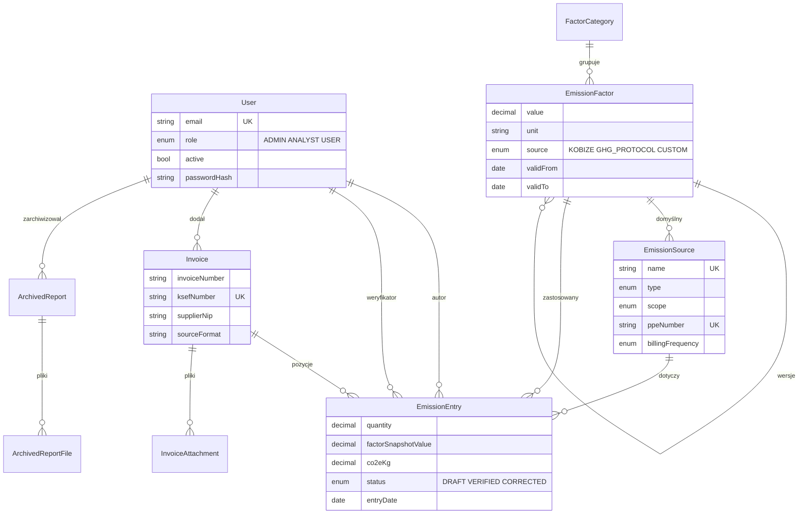

# Baza danych

Schemat zdefiniowany jest w `prisma/schema.prisma`, a jego historia — w migracjach SQL w `prisma/migrations/`. Baza to PostgreSQL w usłudze Neon.

## Diagram relacji

Tabele `AuditLog`, `Company` i `LoginAttempt` nie mają relacji (kluczy obcych) — zob. opisy poniżej.

## Tabele

| Model | Opis |
|---|---|
| `User` | Konta. `passwordHash` pusty = zaproszenie jeszcze nieaktywowane. Tokeny zaproszenia i resetu hasła przechowywane są wyłącznie jako skrót SHA-256 (`invitationToken`, `passwordResetToken`) z datą ważności. |
| `EmissionSource` | Źródła emisji (licznik, kocioł, flota…). `scope` wynika z `type`. Klucze dopasowania faktur: `ppeNumber` (unikalny), `meterNumber`, `supplierNip`. `billingFrequency` steruje przypomnieniami. |
| `FactorCategory` | Kategorie wskaźników (słownik edytowany w aplikacji). |
| `EmissionFactor` | Wskaźniki emisji z okresem ważności `validFrom`–`validTo`. Kolejne wersje tego samego wskaźnika łączy `parentId` (linia wersji). Jednostka w formacie `kg CO₂e/<jednostka>`. |
| `Invoice` | Faktura (z KSeF XML, WAPRO MAG lub ręczna). Unikalność: `ksefNumber` oraz para `supplierNip` + `invoiceNumber`. `rawPayload` przechowuje odczytane dane źródłowe. |
| `InvoiceAttachment` | Pliki faktury w Vercel Blob: `SOURCE_XML` (oryginał) lub `EVIDENCE_PDF`. Usuwane kaskadowo z fakturą. |
| `EmissionEntry` | Pojedynczy wpis zużycia i emisji — serce systemu. Zob. „Wpis emisji” niżej. |
| `ArchivedReport`, `ArchivedReportFile` | Zamrożona kopia raportu: parametry (`query`), suma, liczba wpisów oraz pliki PDF/XLSX/CSV w Blob. |
| `AuditLog` | Dziennik zdarzeń. `details` to JSON jako tekst. Wpisy nie są nigdy modyfikowane ani usuwane przez aplikację. |
| `Company` | Dane firmy — zawsze jeden wiersz o `id = "default"`. |
| `LoginAttempt` | Nieudane próby logowania (do blokady czasowej). Czyszczone po udanym logowaniu i po zmianie hasła. |

## Wpis emisji

`EmissionEntry` zapisuje wszystko, co jest potrzebne do odtworzenia wyniku bez sięgania do aktualnego katalogu wskaźników:

| Pole | Znaczenie |
|---|---|
| `quantity`, `unit` | Ilość po przeliczeniu na jednostkę wskaźnika (np. kWh) |
| `originalQuantity`, `originalUnit` | Ilość z faktury przed przeliczeniem (np. MWh) — gdy jednostki się różniły |
| `factorSnapshotValue`, `factorSnapshotUnit` | **Migawka** wskaźnika z chwili zapisu |
| `co2eKg`, `co2eTon` | Wynik: `quantity × factorSnapshotValue` |
| `entryDate` | Data, według której wpis trafia do okresu raportu: koniec okresu rozliczeniowego faktury, a gdy go brak — data wystawienia |
| `status` | `DRAFT` (szkic) → `VERIFIED` (zweryfikowany) → `CORRECTED` (skorygowany) |

Późniejsza zmiana wartości wskaźnika **nie zmienia** zapisanych wpisów zweryfikowanych. Szkice można przeliczyć jawnie przyciskiem w zakładce Współczynniki (akcja `recalculateDrafts`).

## Migracje

- Nowa migracja (lokalnie, na bazie deweloperskiej): `npm run db:migrate -- --name opis_zmiany` — tworzy plik SQL w `prisma/migrations/` i stosuje go.
- Wdrożenie migracji na bazę produkcyjną: `npm run db:deploy` (`prisma migrate deploy`) — stosuje tylko jeszcze niezastosowane pliki, niczego nie generuje.
- Klient Prisma generowany jest automatycznie po `npm install` (`postinstall`) do `lib/generated/prisma/`.
- `prisma.config.ts` używa `DIRECT_URL`, a gdy go brak — `DATABASE_URL`. Do migracji zalecane jest połączenie **bez poolera** (zob. Konfiguracja).
- Migracji już wdrożonych **nie edytuje się** — każda zmiana schematu to nowy plik.

## Dane startowe

`npm run db:seed` (`prisma/seed.ts`) dodaje bazowe wskaźniki KOBIZE i GHG Protocol oraz — dla środowiska demonstracyjnego — przykładowe źródła i historię faktur z `example/demo/historia/`. Skrypt jest idempotentny dla wskaźników, ale **nie należy go uruchamiać na produkcji z danymi klienta**, jeśli nie są potrzebne dane demonstracyjne.
